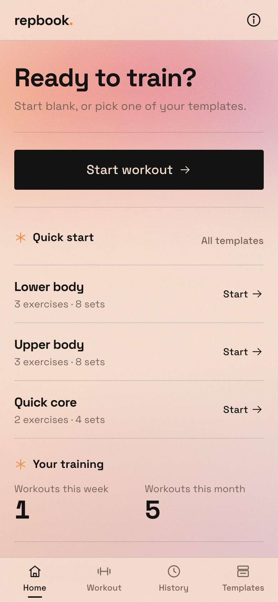
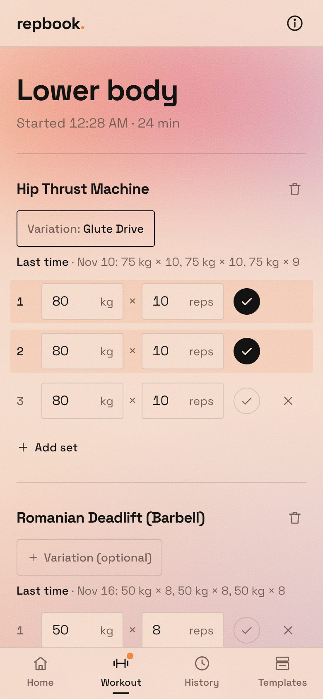
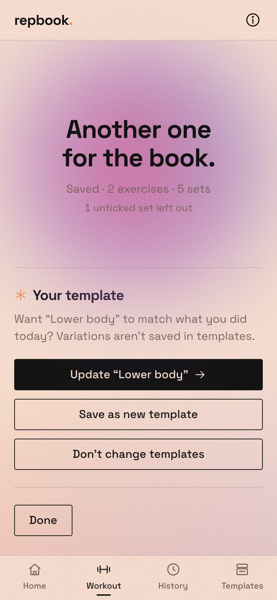
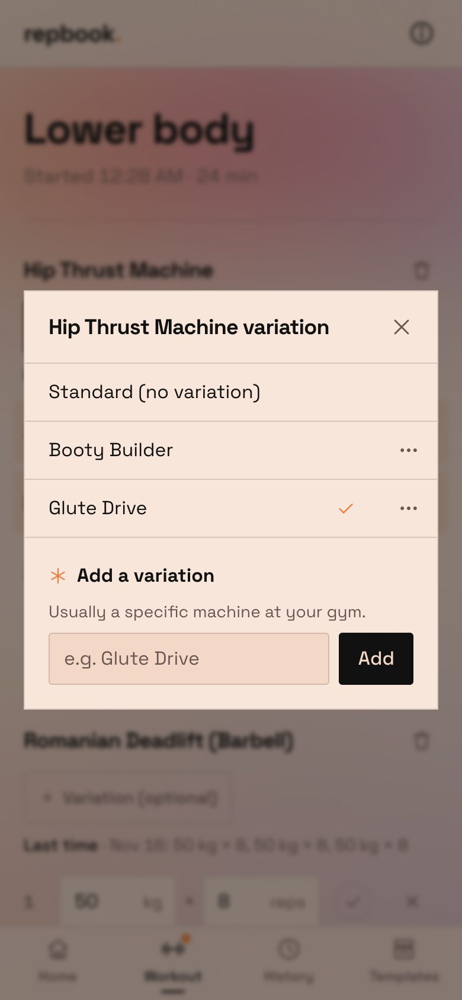
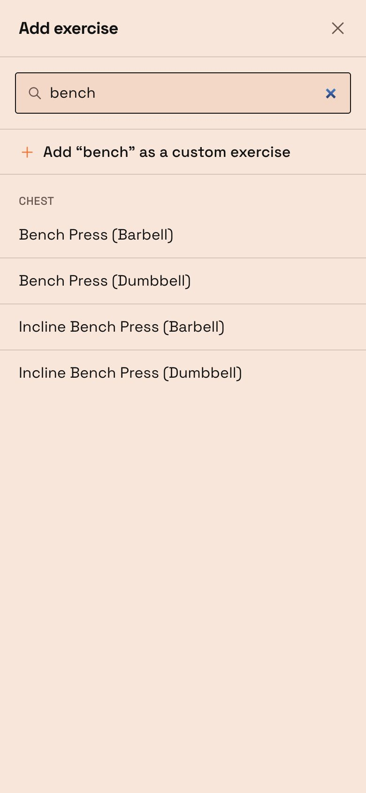
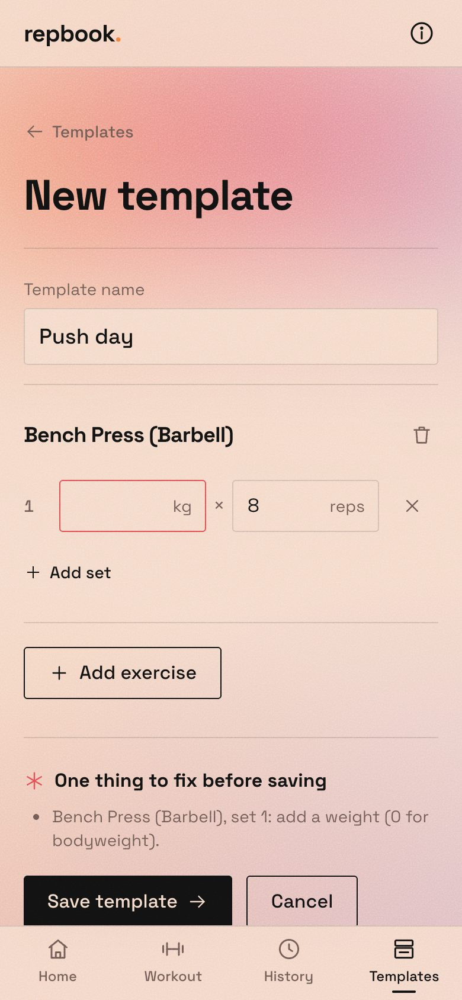
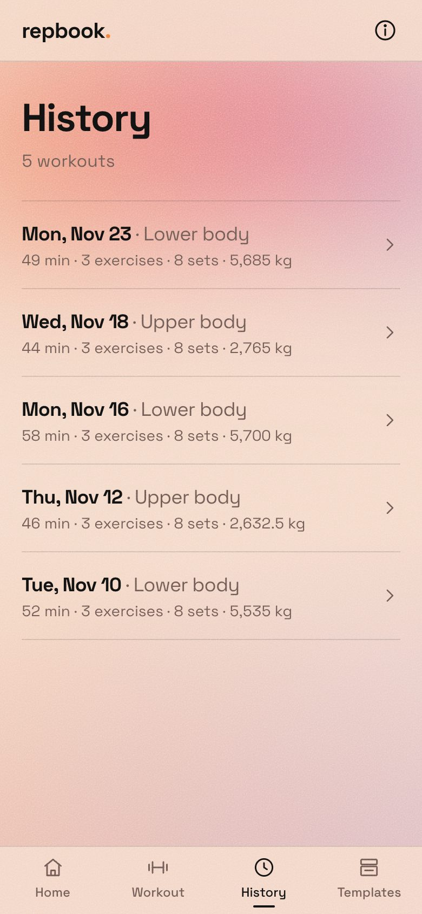
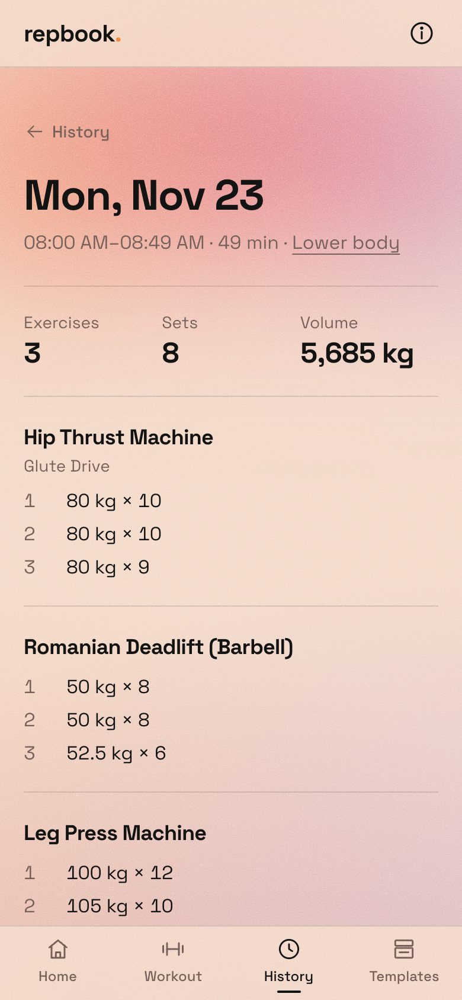
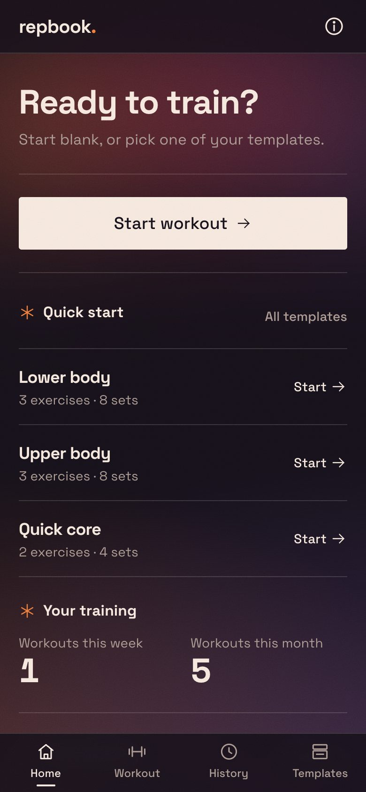
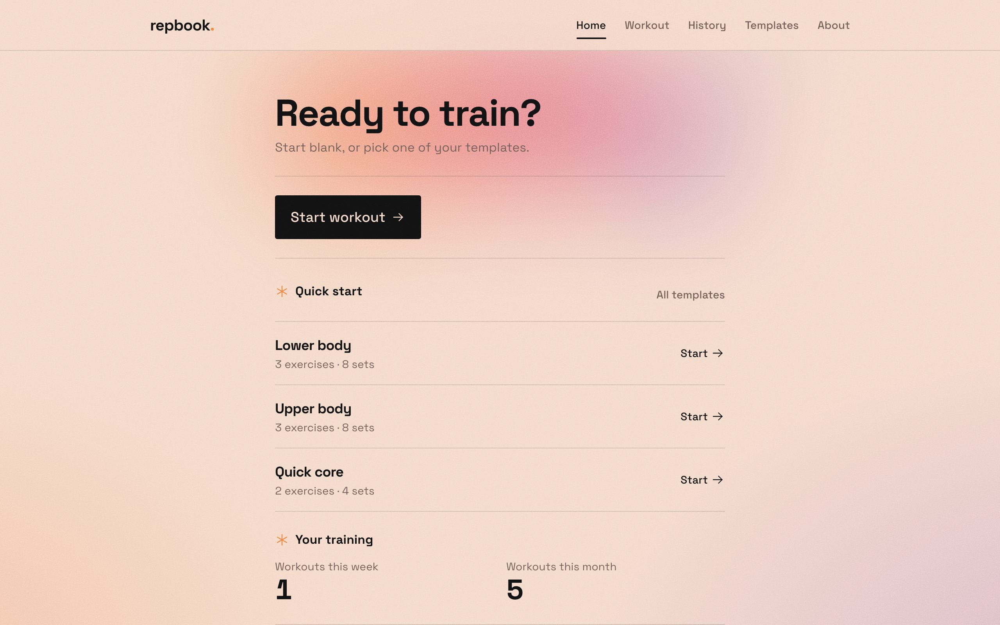

# repbook.

A calm, simple workout logger for busy people who train two or three times a week, often at different gyms.

Save the routines you do most, tick off sets as you go, and see what you lifted last time so you know what to aim for. Everything stays in your browser: no account, no sign-up, no server.

<p>
  
  
  
</p>

## What we built

Repbook is a Next.js app that runs locally. It has four main sections (**Home, Workout, History, Templates**) plus an About page. On a phone they sit in bottom tabs; on a laptop, in a top bar.

### Log a workout

- Start a blank workout, or start one of your templates in one tap from Home or the Workout tab.
- Add exercises from a searchable library of about 40 built-ins, grouped by muscle group, or add your own custom exercises.
- Enter weight (kg, 0 for bodyweight) and reps for each set. **Add set** copies the previous set's numbers.
- **Tick ✓ each set as you finish it.** Only ticked sets are saved, so planned sets you skip don't end up in your history.
- The workout survives a page refresh. While it's running, a "Workout in progress · Resume" bar and a dot on the Workout tab follow you around the app.

### Variations: different machines, separate numbers

A variation is a specific version of an exercise, usually a particular machine at one of your gyms (e.g. Hip Thrust Machine → "Glute Drive" or "Booty Builder"). Pick or add one while you train. The **"Last time"** hint under each exercise matches the exercise *and* the variation, so the numbers from one machine never get mixed up with another's.

<p>
  
  
</p>

### Templates

- Create, view, edit, clone and delete templates (up to 20, with unique names).
- A template can't be saved with a missing weight or reps. The problem set is outlined and the message says exactly what to fix.
- When you finish a workout you choose what happens to your templates: **save it as a template** (for blank starts), or **update the template you used / save as new / leave templates alone** (for template starts). Templates store exercises and sets, never variations, because you pick the machine on the day.

<p>
  
</p>

### History

- Past workouts, newest first, each showing date, duration, exercises, sets and total volume.
- Open a workout to see every set, then edit or delete it. History and the Home summary update straight away.
- Home shows your workouts this week (weeks start on Monday) and this month, plus your last workout.

<p>
  
  
</p>

### Design: "Warm glow"

A peach page with a soft orange → purple glow at the top of each page, a light film-grain texture, Space Grotesk type and thin rule lines instead of heavy cards. Energetic but calm. Light and dark mode follow your system setting, and the layout works at phone and laptop widths.

<p>
  
</p>
<p>
  
</p>

### Where your data lives

Everything is saved in your browser's `localStorage` under one key (`repbook:v1`). That means:

- Workouts logged on your laptop won't appear on your phone.
- Clearing your browser data erases them.
- Safari may clear them on its own if you haven't opened Repbook for about a week.

If storage is full, blocked (e.g. some private browsing modes) or the saved data can't be read, Repbook shows a clear message rather than failing silently.

## Run it locally

You need **Node.js 20.9 or newer** (check with `node -v`).

```bash
cd repbook
npm install
npm run dev
```

Then open [http://localhost:3000](http://localhost:3000). To try the phone layout on a laptop, open your browser's dev tools and turn on device mode.

Other scripts:

| Command | What it does |
|---|---|
| `npm run dev` | Start the dev server at localhost:3000 |
| `npm run build` | Make a production build (also type-checks) |
| `npm run start` | Serve the production build (run `npm run build` first) |
| `npm run lint` | Run ESLint |

**Styles not updating?** The dev server sometimes keeps serving an old stylesheet. Stop it (Ctrl+C), delete its cache with `rm -rf .next/dev` (this doesn't touch your code or workout data), then run `npm run dev` again.

## Tech

- [Next.js 16](https://nextjs.org) (App Router), React 19, TypeScript
- Tailwind CSS 4
- No other libraries. Icons are inline SVG, dialogs use the native `<dialog>` element, and the grain is an SVG noise filter.

## Project layout

```
app/          Pages: Home, workout, history, templates, about, not-found
components/   Shared UI: app shell, exercise editor, pickers, set row, dialogs, glow
lib/          Types, built-in exercise library, storage, store, validation, summaries
docs/         Original build plan, design inspiration and README screenshots
AGENTS.md     Full product spec, agreed decisions and verification checklist
```
